# GOAL-006 Azure Deployment Topology

## Purpose

This contract turns the accepted GOAL-006 constitutional, security, data, and platform decisions into one deployable Azure topology. Infrastructure and workflows MUST implement this contract before another full Demo apply.

## Skills needed for proactive detection

## 1. The six engineering skill areas WAOOAW needs

### 1. Workflow control-flow and state-machine engineering

GitHub Actions · YAML · Bash · dependency graphs · conditional execution

Detect when a completed authority transition causes a required follow-up action to be skipped. Test all combinations of transition state, cache hit/miss, and required refresh—not just the happy path.

### 2. Infrastructure-as-Code and configuration lifecycle engineering

Terraform · Azure Resource Manager · dependency graphs · drift detection

Detect when Terraform believes infrastructure is converged but a runtime configuration value is stale. Understand resource dependencies, plan provenance, secret references, and whether a change actually propagates to its consumers.

### 3. Secrets and runtime configuration engineering

Azure Key Vault · managed identities · secret versions · container configuration

Detect unresolved placeholders, stale secret values, incorrect identity permissions, and consumers that have not reloaded updated configuration. Distinguish a successful secret write from successful consumption.

### 4. Cloud networking and runtime connectivity engineering

Azure Container Apps · DNS · TCP · ingress · VNet · private endpoints

Verify DNS resolution and actual TCP reachability from the consumer's network context. Know how to distinguish an incorrect hostname, a DNS issue, unreachable ingress, and an upstream database failure.

### 5. Deployment qualification and failure-injection testing

Python · pytest · shell tests · contract tests · fault injection

Reproduce skipped stages, stale secret references, unresolved realm placeholders, unreachable database endpoints, and missing evidence artifacts in automated tests before paying for another full workflow run.

### 6. Observability and automated incident diagnosis

Azure CLI · structured logs · execution IDs · telemetry · failure classification

Make every failed migration expose its execution ID, sanitized container logs, effective endpoint metadata, and failed health check automatically. A GitHub step should report the underlying exception, not merely `Billing migration failed: Failed`.

## Deployment Operator Handbook

This section is the canonical operational entry point for deployment strategy, architecture,
tooling, sequencing, evidence, recovery, and frequently asked questions. It explains the executable
contracts without replacing them. When prose and executable behavior differ, deployment stops until
the contradiction is resolved; an operator must not choose the more permissive interpretation.

### Source-of-truth hierarchy

| Question | Authoritative source |
|---|---|
| Is deployment currently authorized? | `constitution/PROJECT_STATE.md`, the assigned Work Contract, the GitHub environment, and the current Founder instruction |
| What architecture is permitted? | This document, ratified claims, accepted ADRs, and the environment's approved component contracts |
| What does the deployment execute? | `.github/workflows/deploy.yaml` and its reusable workflows |
| Which release is deployable? | Successful current-main CI release evidence and `scripts/goal006_registry_manifest.py` |
| Which infrastructure does Terraform own? | `infrastructure/terraform/phase2/environments/<environment>/` and its remote state |
| Which runner infrastructure is permitted? | `infrastructure/deployment-stacks/goal006-runner/` and its reviewed bootstrap manifest |
| What happened in a particular run? | GitHub Actions logs plus uploaded plan, policy, provenance, transition, migration, cleanup, and verification evidence |
| What is live now? | Azure read-only inventory and the current `constitution/PROJECT_STATE.md` checkpoint |

`G5 CLEAR`, an approved Work Contract, a successful plan, or an earlier accepted run satisfies only
its own gate. None of them independently authorizes a new cloud mutation.

### Deployment strategy

1. **Build once, promote unchanged.** CI builds, scans, attests, and publishes one exact-seven
   release tuple. Deployment promotes immutable digests; it never rebuilds application images.
2. **Separate release from control logic.** Normal deployment uses trusted workflow logic from
   `main`. A Founder-authorized break-fix may use an exact control SHA while still deploying the
   trusted current-main release SHA. Both identities are recorded and verified.
3. **Plan before mutation.** Foundation, dormant workload, and application activation each produce
   saved Terraform plans. Policy and provenance bind authorization to the exact plan binary, JSON
   representation, state lineage/serial, backend, environment, release, workflow run, and attempt.
4. **Dependencies before applications.** Network, identity, state, secrets, PostgreSQL, PgBouncer,
   Keycloak, Temporal, Redis, and migrations become ready before exact-seven applications activate.
5. **Verify independently.** Deployment success is not acceptance. A distinct environment-scoped
   OIDC identity runs live inventory, revision, endpoint, domain, and functional verification.
6. **Clean up even on failure.** Private runner execution, registration, broker tokens, temporary
   federation, and transition-only authority are removed by always-run cleanup paths.
7. **Fail closed.** Unknown transition state, stale release, plan error, drift on a cache hit,
   mismatched provenance, policy failure, migration failure, cleanup uncertainty, or failed
   verification prevents success and URL publication.

### Release and runtime component model

The exact-seven release tuple contains only first-party application workloads:

| Release member | Azure Container App | Responsibility |
|---|---|---|
| `constitutional-engine` | `ca-<environment>-constitutional-engine` | Constitutional validation and evidence enforcement |
| `business-platform` | `ca-<environment>-business-platform` | Customer, relationship, employment, and institutional APIs |
| `professional-runtime` | `ca-<environment>-professional-runtime` | Digital-professional execution runtime |
| `ai-runtime` | `ca-<environment>-ai-runtime` | Governed model and inference runtime |
| `web` | `ca-<environment>-web` | Customer and steward web experience |
| `billing-engine` | `ca-<environment>-billing-engine` | Billing authority, integrity, and reconciliation |
| `agent-runtime-adapter-digital-marketing` | `ca-<environment>-dma` | Digital Marketing Agent runtime adapter |

The following are pinned platform dependencies, not additional release members:

| Dependency | Placement | Deployment role |
|---|---|---|
| Identity edge | Internal-to-public constrained proxy | Exposes only approved Keycloak/OIDC paths |
| Keycloak | Private ACA application | Identity provider and realm authority |
| Temporal | Demo ACA dependency; later-environment contract per ADR-015 | Durable workflow execution |
| Authentication Redis | Private ACA dependency | Reconstructible abuse-limiter counters only |
| PostgreSQL Flexible Server | Private environment database | Durable governed state |
| PgBouncer | Private ACA TCP service | Only application database route |
| Migration jobs | ACA manual Jobs | Keycloak, Temporal, and Billing schema transitions |
| Verification job | ACA manual Job | Private-context post-deployment checks |

### Tooling map

| Tool or script | Purpose | Security/evidence boundary |
|---|---|---|
| GitHub Actions | Orchestration, protected environments, OIDC, artifacts | Repository and environment policies determine who may execute |
| GHCR | Immutable application and runner images | Digests and attestations are verified before deployment |
| Azure CLI | Azure control-plane orchestration and read-only evidence | Runs only under the identity assigned to that step |
| Terraform `1.9.8` | Foundation and workload planning/apply | Uses remote private state, saved plans, and no provider auto-registration |
| `goal006_tfplan_policy.py` | Plan policy enforcement | Emits PASS evidence bound to the exact plan JSON |
| `goal006_plan_provenance.py` | Plan provenance | Binds environment, release, run, backend, state, policy, JSON, and binary digests |
| `wc124_deployment_bundle.py` | Activation authorization bundle | Requires current validated foundation and workload evidence |
| `wc124_database_transition.py` | Database authority state machine | Unknown or inconsistent live facts produce `RECOVERY_HOLD` |
| `wc124_db_provisioner.py` | Roles, grants, credentials, databases, additive migrations | No secret values in logs; temporary authority only |
| `wc124_db_handoff.py` | Ownership and recovery verification | Proves ownership, sessions, dependencies, and revocation readiness |
| `goal006_bind_demo_managed_certificates.sh` | Idempotent Demo TLS binding | Verifies all required custom domains reach `SniEnabled` |
| `goal006_verify_deployment.sh` | Independent deployment verification | Runs through the separate verification identity and private job |
| Actionlint, pytest, HCL parser, shell checks | Deterministic local validation | Required before paying for another cloud execution |

### Private runner image supply chain

The private runner contains deployment tools under `/opt/waooaw/`, including the WC-124 database
provisioner. A workflow checkout does not replace those baked tools. Every deployment therefore
binds the broker, runner, and cleanup executions to one immutable runner digest.

| Path | Image behavior | Required evidence |
|---|---|---|
| Pull request | `private-runner-image.yaml` builds, validates, lease-tests, and scans the proposed runner without publishing it | Build, toolchain, real lease, and vulnerability gates pass |
| Push to `main` affecting runner inputs | The private-runner image supply chain publishes and attests `sha-<main SHA>` and records its immutable digest | Successful image workflow plus retained digest manifest and attestation |
| Normal main deployment | `build-break-fix-runner` is skipped. Broker, runner, and cleanup use the reviewed digest already promoted into the environment runner blueprint | Blueprint digest equals the approved main runner release |
| Authorized break-fix deployment | A hosted job builds the exact control SHA, resolves the pushed tag to an immutable digest, and passes that digest through `deploy.yaml` to the broker, runner, and cleanup execution overrides | Built digest equals every execution digest; a published-but-unused image is a failure |

The hosted break-fix build commonly takes about two minutes because it rebuilds and pushes the
complete runner toolchain. It is required when the control SHA changes any baked runner input. It
does not rebuild the exact-seven application release.

After a runner-affecting PR merges, the main image workflow publishes the main-SHA image. That
digest must be reviewed and promoted into the deployment-stack parameters before a normal main
deployment relies on the changed baked tooling. A normal deployment must not silently use a branch
image, mutable tag, or unpromoted digest.

### Identity and authority boundaries

| Identity | Permitted authority | Explicitly not permitted |
|---|---|---|
| Control-plane OIDC | Resolve configuration, broker/runner control, complete foundation plan/apply, shared state-account RBAC and runner networking | Workload secret data-plane use |
| Environment deployment OIDC | Environment workload resources, workload Terraform, environment Key Vault references | Bootstrap administrator or unrestricted subscription authority |
| Database bootstrap identity | Temporary PostgreSQL Microsoft Entra administrator lifecycle | Persistent application access |
| Database provisioner identity | Temporary database/role/credential provisioning and exact Key Vault secret writes | Remaining after handoff |
| Cleanup identity | Runner/broker cleanup and evidence upload | Deployment or workload mutation |
| Independent verification OIDC | Read/execute only the approved verification surface | Deployment mutation |
| Workload managed identities | One service and purpose-specific secret/data boundary | Shared multipurpose credentials or cross-environment access |

Terraform backend access and Azure resource-management authority are independent controls. A
principal that can read state does not automatically have deployment authority, and a deployment
principal does not automatically have state data-plane access.

### End-to-end execution sequence

The GitHub UI may materialize downstream jobs as `queued` before their dependencies complete.
`needs` still enforces the order below. A queued job with no runner and no steps normally has not
executed, but operators must reconcile that projection with downloadable logs, run-scoped artifact
timestamps, and released downstream dependencies before diagnosing a scheduler wait.

| Phase | Executable sequence | Required result |
|---|---|---|
| 1. Entry authorization | `deploy.yaml` resolves environment, execution mode, trusted release SHA/run, control SHA, lease, and normal versus break-fix caller | Exact bounded authority or stop |
| 2. Break-fix runner image | Only for authorized break-fix: build and push the private-runner image at the exact control SHA, resolve its digest, and bind that digest to broker, runner, and cleanup executions | Built and executed immutable runner digest match |
| 3. Environment resolution | Resolve reviewed configuration, runner names/labels, state paths, cleanup evidence, and environment outputs | One internally consistent environment contract |
| 4. Broker/start path | Verify exact-seven tuple and attestations, verify broker blueprint, log in with control-plane identity, enforce cost, start ephemeral private runner | Correlated runner execution ready |
| 5. Private-runner authorization | Verify caller/ref, pinned Terraform, OIDC subscription, provider allowlist, budget, cost, backend, and configuration | Private deployment may proceed |
| 6. WC-124 transition resolution | Read password-auth state, bootstrap administrator count, provisioner vault roles, secret metadata, and accepted digest | `PLAN_A`, `PLAN_B_ENABLED`, `REVOCATION_PENDING`, `REVOKED`, or fail-closed `RECOVERY_HOLD` |
| 7. Foundation plan | Refresh complete foundation state, create a current saved plan, apply detailed exit handling, policy, and provenance | Exit `0` or authorized `2`; exact evidence PASS |
| 8. Foundation apply | Apply only the saved and validated plan; resolve environment identities, PostgreSQL, Key Vault, network, and verification outputs | Foundation converged |
| 9. Credential and database handoff | Inventory credentials, seed only missing values, establish deterministic vault-scoped reconciliation authority, prove data-plane access, provision or reconcile without rotation, verify ownership, and revoke temporary authority | Reconciliation succeeded; deterministic temporary assignment absent; transition-owned authority preserved only for its lifecycle |
| 10. Dormant workload plan | Generate external configuration, set application activation false, import only accepted live resources, plan, policy-check, and provenance-bind | Current workload authorization evidence |
| 11. Activation bundle | Validate foundation and workload plan binaries, JSON, provenance, policy, release, environment, workflow, backend, and state identity | Internal WC-124 activation bundle PASS |
| 12. Dormant workload apply | Create dependencies, migration jobs, identities, secret references, and applications at zero replicas | No application traffic yet |
| 13. Migrations | Inventory exact migration jobs, verify version-qualified Key Vault references, prove same-ACA PgBouncer DNS/TCP, run Keycloak, Demo Temporal, and Billing, and retain executions plus sanitized logs | All required executions `Succeeded`; persisted migration acceptance PASS |
| 14. Activation plan/apply | Require migration acceptance, set application activation true, create a fresh detailed-exit plan, policy and provenance record, recalculate and compare provenance immediately before apply, and retain the apply log | Only exact authorized activation plan applied with complete evidence |
| 15. TLS and deployment evidence | Bind Demo managed certificates; verify structured SNI inventory; verify live inventory and transition/cleanup evidence; upload retained activation and TLS artifacts | Deployment engine success with no missing required evidence |
| 16. Always-run cleanup | Stop private runner, remove registration/broker material, prove zero active executions, revoke temporary cleanup federation | No residual runner or temporary trust |
| 17. Independent verification | Validate trusted caller/control SHA, trusted release, Azure inventory, job, revision, domain, and application probes under verification identity | Independent PASS |
| 18. Publication | Publish the verified environment URL only after deploy and verification succeed | User-visible success |

### Terraform plan and cache semantics

| Detailed exit code | Meaning | Required behavior |
|---|---|---|
| `0` | Plan succeeded with no changes | Produce plan, policy, and provenance evidence; continue according to mode |
| `2` | Plan succeeded and detected changes | Treat as drift/change, never as automatic apply permission; require the relevant authorization and policy PASS |
| `1` or any other code | Planning failed | Stop; do not create success-shaped evidence |

A foundation cache may avoid an unnecessary apply, but it may never replace a current plan. Drift
detected on a cache hit stops before apply. File existence alone is insufficient: every consumed
plan must match the intended environment, release SHA/run, workflow run/attempt, Terraform root,
backend key, state lineage/serial, policy result, plan JSON digest, and saved-plan binary digest.

### Database and migration sequence

1. Applications use `ca-<environment>-pgbouncer:5432` for same-ACA-environment TCP service
   discovery. The internal-ingress FQDN is not the application connection hostname.
2. Every Demo/UAT apply reconciles existing URL and Npgsql credentials to that short-name route,
   even after the WC-124 authority transition is complete. Reconciliation preserves passwords,
   roles, database names, raw-password secrets, and the PgBouncer authfile.
3. Reconciliation authority is one deterministic `Key Vault Secrets Officer` assignment for the
   exact provisioner principal and exact environment vault. The workflow classifies the exact
   assignment as created by the current execution or an adopted orphan. It separately resolves the
   transition-owned assignment from Terraform state, rejects every assignment whose ownership is
   not positively established, and never removes transition-owned authority during reconciliation
   cleanup.
4. The provisioner performs a bounded data-plane authorization probe before reading or writing
   credentials. Authorization propagation may retry; an unexpected error or timeout fails closed.
   The deterministic reconciliation assignment is revoked immediately after reconciliation and
   independently recomputed and removed by final idempotent cleanup. Cleanup failure fails the
   deployment and emits non-secret ownership/status evidence for recovery on the next run.
5. The deployment records the resulting Key Vault versions and passes version-qualified database
   secret references into the Terraform workload plan. A successful Key Vault write alone is not
   propagation evidence: before starting a migration, the workflow inventories its effective ACA
   Job and rejects absent or versionless Key Vault references.
6. After the dormant workload exists, the still-private provisioner ACA Job runs a sanitized
   network-only probe against `ca-<environment>-pgbouncer:5432`. DNS resolution and TCP connection
   must both succeed from the workload ACA environment before any migration SQL runs.
7. Keycloak and Temporal migration jobs use their approved direct PostgreSQL migration contracts.
   Application runtime traffic continues through PgBouncer.
8. The Keycloak realm import substitutes every secret placeholder inside the job, checks that no
   `${NAME}` placeholder remains, and then imports. Secrets stay in Key Vault-backed ACA secret
   references and are never written to logs or Terraform state.
9. Each application migrator receives only its no-login owner role and a database-local default
   role. Runtime roles do not acquire DDL authority.
10. Billing writes its immutable migration ledger in the governed `billing` schema and runs through
   PgBouncer using the exact `db-billing-migration` credential.
11. Migration job names are producer-consumer contracts:
   `job-<environment>-keycloak-migration`,
   `job-<environment>-temporal-migration`, and
   `job-<environment>-wc124-billing-migration`.
12. Keycloak, Temporal, and Billing retain the exact ACA job definition, execution record, and
    sanitized console log. A timeout, `Failed`, `Stopped`, unknown status, digest mismatch,
    unresolved secret placeholder,
   ownership error, or connection error blocks application activation. The owning workflow step
   emits the ACA execution ID and sanitized container logs before cleanup and artifact retention.

### Downstream activation and release acceptance

Database success is not inferred from step ordering. Before application activation, the workflow
creates `wc124-migration-acceptance.json` only after the private PgBouncer preflight, required vendor
migrations, Billing migration, and immediate temporary-authority revocation are all proven. The
record binds SHA-256 digests of the authority and migration evidence used for the decision.

Activation then creates a new saved plan with policy and provenance, recalculates provenance against
the current state immediately before apply, and retains the activation plan JSON, binary, policy,
provenance, and apply log. Demo TLS binding retains a structured per-application custom-domain
inventory and fails unless every required application has an `SniEnabled` binding. Independent
verification treats missing required evidence as an error, and the verified URL is published only
when deployment cleanup and independent live verification both succeed.

### Evidence inventory

| Evidence | What it proves |
|---|---|
| Release verification and registry manifest | Exact current-main release run, SHA, seven digests, and attestations |
| Foundation/workload/activation plan JSON and binaries | Exact proposed infrastructure change |
| Policy result | The corresponding plan passed executable policy |
| Plan provenance | Plan, state, backend, environment, release, and workflow binding |
| WC-124 activation bundle | Both prerequisite plans were current and mutually consistent |
| Transition and handoff records | Database authority moved to the intended final state |
| Reconciliation authority record | Deterministic ownership classification, immediate revocation, final recovery, and verified absence |
| PgBouncer preflight record | Same-ACA short-name DNS resolution and TCP connectivity before migration SQL |
| Migration job and execution records | Exact effective job, version-qualified secret references, execution/status, and sanitized logs |
| Migration acceptance record | Required migrations, connectivity, and temporary-authority revocation passed before activation |
| Activation plan, provenance, policy, and apply log | Exact post-migration activation mutation and its retained result |
| Runner start/cleanup correlation evidence | The runner that started is the runner that was removed |
| Temporary federation inventory | No break-fix cleanup trust remains |
| Structured TLS inventory and log | Required custom domains have managed `SniEnabled` binding |
| Independent verification output | Live deployment matches release and functional contracts |

GitHub logs aid diagnosis but are not the sole durable constitutional evidence. Secret values,
access tokens, connection URLs containing credentials, and unredacted Terraform sensitive values
must never be logged or uploaded.

### Failure diagnosis order

Do not rerun the full workflow immediately. Find the first causal failure, then trace the exact
producer-consumer contract and execute the smallest real component in its Azure context.

1. Confirm run SHA, release SHA, control SHA, environment, execution mode, and caller authorization.
2. Reconcile the public job state with its logs, artifacts, and dependency progression. `queued`
   plus `runner_name: null`, no downloadable log, no run-scoped artifact, and no released dependent
   job means scheduler wait. A downloadable log or artifact created by that job proves execution
   even when the public job/check projection remains stale.
3. Inspect the first failed step, not the final skipped job.
4. Compare resource names and outputs between Terraform producers and workflow consumers.
5. Validate effective configuration from inside the failing ACA job without printing secrets.
6. For network failures, test destination parsing, DNS, then TCP from the same ACA environment.
7. For Terraform, record the detailed exit code and validate plan provenance before discussing
   apply.
8. For database failures, separate DNS/TCP, PgBouncer reachability, authentication, role/ownership,
   schema, and migration-content failures.
9. Run the corrected component directly where authority permits; only then spend another full
   deployment run.
10. Preserve the failed run URL, job/execution ID, exact error, live facts, fix, and successful
    component evidence for the PR.

### Operator checklist

Before execution:

- Bootstrap and office authority are current for the conversation.
- The current Work Contract and Founder authorization cover the environment and mutation.
- The branch, release, control SHA, and break-fix mode match the authorized path.
- Targeted tests, workflow lint, Terraform/HCL checks, and producer-consumer contract tests pass.
- No unresolved blocker, stale plan, destructive change, or unexplained drift remains.

Before declaring success:

- Every required migration reached `Succeeded`.
- Application activation used the exact saved plan whose policy/provenance was revalidated.
- All target apps and revisions are running at the intended digests.
- Managed TLS and custom domains are healthy where applicable.
- Independent verification passed.
- Bootstrap administrator, provisioner Key Vault roles, temporary federation, runner executions,
  registrations, and broker tokens are all at their accepted final counts.
- Evidence artifacts are uploaded and retained.
- The PR records exact commands/results and the final Actions run URL.

### Frequently asked questions

**Why are several jobs shown as queued before `authorize` finishes?**

GitHub creates the workflow graph up front. `needs` still enforces execution order. Jobs with no
runner, no downloadable log, no job-produced artifact, and no released dependent job have not run.

**Why can an `ubuntu-latest` job remain queued?**

If no repository run holds the concurrency group, `runner_name` is null, logs are unavailable, no
job-produced artifact exists, and no dependent job has been released, the run is waiting at
GitHub's hosted-runner scheduler or account-capacity layer. WAOOAW private runner provisioning has
not started.

**Why can a run create artifacts while every job still appears queued?**

The public Actions run, job, and check projections can lag or become inconsistent with the
orchestrator. Treat run-scoped artifact creation, downloadable job logs, and dependency release as
proof that execution occurred. Determine the real terminal result from the log and retained cleanup
evidence; do not cancel or rerun solely because the displayed status remains `queued`.

**Will `Publish exact break-fix private runner` run after merge to `main`?**

Not as part of a normal deployment. The job is conditional on `break_fix == true`. A runner-affecting
push to `main` instead invokes the separate private-runner image supply chain, which builds, pushes,
attests, and records the main-SHA image. Normal deployment consumes only a reviewed digest promoted
into the environment runner blueprint.

**Why must a break-fix publish a private runner before deployment?**

Workflow and Terraform files come from the control-SHA checkout, but tools under `/opt/waooaw/` are
baked into the runner image. The exact break-fix digest must reach the broker, private runner, and
cleanup executions; merely pushing an unused image does not update those tools.

**Does Terraform exit code `2` mean failure?**

No. It means a valid plan detected changes. It also does not authorize apply.

**Can a cache hit omit the foundation plan?**

No. Every apply path needs a current plan. Cache controls apply necessity, not evidence production.

**Why keep release SHA and control SHA separate?**

The release SHA identifies immutable application artifacts from trusted current-main CI. The
control SHA identifies the exact workflow/scripts executing an explicitly authorized break-fix.

**Why not connect applications to PostgreSQL directly?**

The accepted application route is PgBouncer with environment-specific credentials and connection
budgets. Migration-only direct routes are separately bounded.

**Why does ACA use the short PgBouncer name?**

Same-environment custom TCP service discovery is proven through
`ca-<environment>-pgbouncer:5432`. The internal-ingress FQDN resolved but was not reachable for
this path during WC-124 qualification.

**Can a failed migration be ignored if applications are healthy?**

No. Dormant applications may exist, but activation is blocked until every required migration
succeeds.

**Can deployment and verification use the same identity?**

No. Verification is deliberately independent and cannot inherit deployment mutation authority.

**Can evidence be added to a PR after it opens?**

Yes. Update the PR body or add an evidence comment with the exact run URL, SHA, commands, and
results. Never change a `PENDING` result to `PASS` before the run reaches terminal success.

**When is a PR ready for Founder review?**

After scoped author review, required tests and prechecks pass, the branch is pushed, the PR body is
prepared against the authoritative remote HEAD, deployment evidence is current, and no required
result remains pending. The author never merges the PR.

### Next-agent handoff

A new deployment agent should be able to continue using only:

1. `constitution/BOOTSTRAP.md`, `README.md`, and `constitution/PROJECT_STATE.md` in the required
   bootstrap order;
2. this handbook;
3. the assigned Work Contract or issue;
4. the exact GitHub Actions run and current branch diff;
5. only the scripts, Terraform roots, and tests that own the failing phase.

The handoff must state: role, authority, environment, branch, HEAD, trusted release SHA/run, control
SHA, transition state, last successful phase, first causal failure, Azure component evidence,
remaining work, tests executed, uncommitted files to exclude, PR status, and whether any watcher or
background process remains active.

## Skill 17 Cloud Delivery Entry Point

This document is the canonical implementation design for Platform IT Expert Skill 17 cloud-delivery
work. Skill 17 supplies the professional capability; it does not permit a new topology or create
cloud authority. The current authority and stop conditions come from `constitution/PROJECT_STATE.md`
and the assigned Work Contract. ADR-047 controls the private runner decision. If any of those inputs
is missing, inconsistent, or unapproved, execution stops rather than selecting another cloud path.

| Concern | WAOOAW direction |
|---|---|
| Strategy | Azure-first with application-layer portability and a named escape hatch for each Azure-specific dependency. |
| Design | GitHub Actions OIDC, immutable GHCR digests, isolated Azure Container Apps environments, managed identities, Key Vault, private networking, PostgreSQL, and OpenTelemetry/Azure Monitor. |
| Delivery | Build the exact-seven tuple once, promote the same digests through Demo, UAT, and Production, and fail closed on authorization, cost, security, recovery, or evidence failure. |
| Runner path | A GitHub-hosted management job reconciles the Azure Deployment Stack; an ephemeral environment runner performs private deployment; independent cleanup removes its registration, token, and execution. |
| Sequence | Qualify Demo first, obtain Founder Demo acceptance before UAT, and keep Production dark and plan-only until separately authorized. |
| Operating posture | Prefer local deterministic validation for fast iteration, but use the protected workflow to prove OIDC identity, private DNS/data paths, environment approval, cleanup, and immutable evidence. |

### Founder Demo Database Standard - Binding Decision 2026-10-16

The Founder supersedes the WC-091 disposable Demo database variance and the 2026-10-15 CB-019
Demo-container route. Demo now follows the UAT database standard with environment-specific,
low-cost capacity: one persistent, private Azure Database for PostgreSQL Flexible Server, separate
databases and least-privilege roles for application state, Keycloak, Web sessions, and approved
dependencies, and one dedicated PgBouncer infrastructure dependency as the only application
database route. PostgreSQL sidecars in Constitutional Engine, Business Platform, Billing Engine,
Keycloak, Web, and self-hosted Demo Temporal are prohibited.

This decision preserves the constitutional promotion model: the exact-seven application image
digests are built once and promoted unchanged through Demo, UAT, and Production. Environment
database endpoints, credentials, capacity, retention, and dependency configuration remain external
deployment inputs. Demo may select the lowest qualified Flexible Server and PgBouncer capacity, but
cost does not permit a different database authority, a public/direct route, missing recovery
evidence, shared credentials, or application-image changes.

Demo deployment no longer wipes database state. It applies additive migrations before traffic and
must prove backup, PITR, isolated sanitized restore, restart continuity, rollback compatibility,
private routing, and the reviewed connection budget. Demo and UAT remain isolated: neither database,
credential, backup, Key Vault version, DNS record, or data set is promoted between environments.
Production topology and activation remain unchanged and separately Founder-authorized.

This architecture decision does not authorize Terraform, workflow, database, secret, cloud,
traffic, UAT, or Production mutation. The existing implementation remains non-conforming until a
separately authorized implementation session removes the sidecars and qualifies the persistent
Demo route.

### Founder Stateful Asset Authority Standard - Binding Decision 2026-10-16

Component ownership means ownership of schema, invariants, migrations, APIs, and least-privilege
database role. It does not permit a component revision to own a replica-local authority datastore.
Tenant relationships, identity links, wallet balances, payment and reconciliation outcomes,
workflow history, session state, constitutional evidence, permanent holds, and durable idempotency
outcomes MUST survive revision replacement and MUST remain in their accepted governed persistent
store.

| Asset class | Permitted responsibility | Prohibited responsibility |
|---|---|---|
| Environment PostgreSQL | Durable component schemas, tenant and relationship state, financial records, constitutional evidence, session state, workflow backing stores, durable holds and idempotency outcomes | Shared unrestricted credentials, cross-schema access outside accepted APIs/roles, public/direct application routes |
| Redis or equivalent transient store | Reconstructible TTL cache, bounded coordination lease, rate-limit counter, restart epoch, and performance acceleration whose loss is detected and safely reconciled | Sole authority for money, tenant/relationship state, identity, sessions, workflow completion, evidence, permanent halt, durable idempotency, or authorization |
| Container filesystem and `EmptyDir` | Scratch files, rendered non-secret configuration, bounded temporary processing, and reconstructible artifacts | Any state required after restart, for tenant isolation, for customer-visible correctness, or as evidence |
| Key Vault | Environment-local secret and key-version authority with one principal and purpose per credential | Business records, workflow state, shared multipurpose credentials, Terraform/workflow value transport |
| Log Analytics and runtime logs | Redacted operational telemetry and diagnosis | Sole constitutional, billing, customer, security-decision, or acceptance evidence |
| Terraform backend Storage | Private infrastructure ownership and plan/state continuity | Customer or application business data |

Redis topology is environment-owned, not revision-owned. A component-local Redis sidecar is
prohibited when more than one revision/replica must observe the same state or when losing that
state can alter a customer, billing, security, or constitutional outcome. An accepted
environment-level transient dependency may be used only with purpose-specific credentials,
namespaces, bounded TTLs, readiness, restart/reconciliation behavior, and negative cross-purpose
tests. If those controls are absent, the component must operate from PostgreSQL or fail closed; it
may not silently create local authority.

The current Billing Redis sidecar is non-conforming. Its thread-catalog and customer-mode entries
are reconstructible caches, but the no-expiry billing-integrity halt and reconciliation
idempotency key affect consequential outcomes. The durable halt, reason, evidence reference,
actor, timestamps, clear decision, and idempotency outcome belong in Billing's governed PostgreSQL
schema. Redis may cache the effective halt or hold a bounded execution lease only when loss,
expiry, or restart cannot clear the durable halt, authorize a duplicate outcome, or convert
uncertainty into success. Billing must fail closed while authoritative halt state cannot be read.

The dedicated authentication abuse-limiter Redis remains conforming because it is
environment-shared, private, transient, contains only keyed TTL counters and restart-epoch
metadata, and Web fails closed during unavailability or the full restart hold. It may not acquire
session, identity, membership, revocation, recovery, or evidence authority.

This decision applies to Demo implementation and to the portable application contract promoted
unchanged to later environments. It does not provision UAT or Production, choose a Production
cache product, authorize cloud mutation, or permit application-image divergence.

### WC-091 Demo Data Amendment - Historical Decision Superseded 2026-10-16

Enterprise Architecture approves the WC091-I1 bounded variance: Demo uses a digest-pinned PostgreSQL
container in ACA with replica-scoped ephemeral `EmptyDir` storage and generation-fenced destructive
initialize-and-seed on every database process start and revision replacement. Demo has no durability,
backup, restore, migration-continuity, or customer-data claim. UAT remains the first environment with
persistent PostgreSQL and recovery qualification. This approval changes architecture only; Founder
acceptance of this exact amendment and separate current-session implementation authorization remain
mandatory before WC091-I1 implementation.

The Founder decision above supersedes this variance for all work after 2026-10-16. This paragraph is
retained only as historical traceability for the sidecar implementation that must now be removed.

### CB-019 Web Session Database Route - Historical Demo Placement Superseded 2026-10-16

The 2026-10-15 amendment formerly placed a wipe-on-deploy PostgreSQL container and custom PgBouncer
DNS route in Demo. The 2026-10-16 Founder Demo Database Standard superseded that physical placement,
ephemeral storage, wipe, hostname, and recovery model. They are not current implementation guidance.

The Founder also binds Production to a separate highly available PostgreSQL instance. It shares no
data, route, DNS, credential, or trust boundary with Demo or UAT; detailed HA design and activation
remain separately gated.

The Founder accepted this bounded architecture amendment on 2026-10-15. The 2026-10-16 Founder
Demo Database Standard supersedes its obsolete Demo placement and connection details. The private
PgBouncer-only application route, least-privilege roles, no-echo credentials, environment
isolation, UAT recovery objectives, and separately gated Production clauses remain binding. Acceptance closes the
CB-019 architecture-input condition but does not authorize cloud mutation, qualification, traffic,
or Production activation. The phase-2 foundation/workload split, dependency manifest, environment
projections, secret provisioning, qualification, and WC-123 impact manifest must follow this
amendment. The legacy `infrastructure/terraform/modules/core` PgBouncer remains non-active evidence
and is not an implementation source.

### WC-089 Exact-Seven Amendment - Founder Directed 2026-09-15

DMA Release 1 is the seventh permanent first-party release workload. It uses the private
`ca-<environment>-dma` Container App, the existing Container Apps Log Analytics integration, and a
Professional Runtime service credential. All seven OCI digests are built, signed, promoted, verified
and rolled back as one tuple. DMA remains separately admitted and gains no platform or customer-state
authority from release membership. This repository change authorizes code and local validation only;
cloud apply remains separately authorized.

### Current Delivery State - 2026-10-19

`constitution/PROJECT_STATE.md` remains authoritative for live authorization. This dated snapshot
records the WC-124 deployment architecture at commit `cebe78c1`. The normative topology below
remains the single strategy source; current execution progress belongs in PROJECT_STATE and the
active Work Contract.

| Area | Verified state | Required next result |
|---|---|---|
| Canonical workflow | `.github/workflows/deploy.yaml` is the only manual application deployment entry and delegates to `environment-deployment.yaml` and `environment-deployment-verification.yaml`. | Preserve one operator entry; reusable workflows remain implementation details with contract tests. |
| Demo | Exact-seven applications, persistent PostgreSQL, PgBouncer, Keycloak, Temporal, Redis, managed TLS, direct component verification, and WC-124 transition controls are implemented. Final branch deployment evidence remains run-specific. | Require terminal deployment and independent-verification PASS before acceptance. |
| UAT | Prior environment delivery exists; WC-124 persistent database and exact-seven promotion must use the same current contracts under separate authority. | Complete only evidence required for UAT qualification; never rebuild accepted images. |
| Runner lifecycle | Demo and UAT use environment-derived ephemeral ACA runners, private state/config access, correlation-checked cleanup, and zero active executions after qualification. | Keep Production runner blueprint inactive and retain no-public-fallback assertions. |
| State path | Shared state-account public access is disabled with default deny and approved private endpoint access. Declarative ownership of the existing shared account remains debt. | Assign accepted IaC ownership before Production readiness; do not reopen public access. |
| Production | Terraform and runner blueprints are code-prepared; protected Production environments and plan prerequisites remain incomplete. No Production plan/apply ran. | Keep Production plan-only and runner `INACTIVE` until a separate Founder authorization. |
| Execution contract | `work-contracts/WC-076-goal006-phase3-execution.md` exists and owns execution closure. | Keep status there and in PROJECT_STATE; do not duplicate live status in strategy documents. |

The detailed topology, controls, interface gates, and implementation order below are normative. This
section is a routing summary and must not be copied into a separate implementation plan.

## Constitutional Delivery Invariants

1. Build the exact-seven application images once. Demo, UAT, Production, and rollback use the same immutable OCI digests.
2. The promoted release tuple is `manifest + seven image digests + reviewed configuration digest + data schema compatibility + evidence`.
3. Images contain no environment configuration or secret values. Runtime configuration comes from reviewed environment configuration, managed identity, and Key Vault references.
4. Demo precedes UAT, and UAT action requires prior explicit Founder Demo acceptance. That prerequisite was satisfied for the accepted PR #371 UAT delivery. Production customer traffic remains Founder-reserved.
5. Every environment has separate state, identity, VNet, data, Key Vault, DNS records, and evidence. Production data never moves down. "Dark Production" means the single Production environment before traffic activation, not a second environment.
6. A failed authorization, cost, security, recovery, or evidence gate stops before mutation.
7. First-party release membership remains exactly seven, including DMA Release 1. Pinned third-party runtime dependencies are recorded in a separately signed dependency manifest bound to the release tuple; they never become mutable or silently expand exact-seven membership.

## Target Topology

```mermaid
flowchart TB
  GH[GitHub Actions OIDC] --> REL[Signed exact-seven release tuple in GHCR]
  REL --> D
  REL --> U
  REL --> P

  subgraph D[Demo - leased]
    DDNS[www.demo / api.demo / auth.demo]
    DING[ACA managed ingress and L7 load balancer\nFounder IPv4 allowlist]
    DAPP[ACA revisions\nWeb, BP, PR, CE, AIR, Billing, DMA, identity edge, Keycloak, self-hosted Temporal, Redis]
    DPGB[Dedicated PgBouncer ACA\nsame-environment TCP service discovery]
    DDB[Persistent private PostgreSQL Flexible Server\nseparate databases and least-privilege roles]
    DKV[Key Vault private endpoint]
    DMON[Log Analytics]
    DDNS --> DING --> DAPP
    DAPP --> DPGB --> DDB
    DAPP --> DKV
    DAPP --> DMON
  end

  subgraph U[UAT - leased, production-shaped]
    UDNS[www.uat / api.uat / auth.uat]
    UING[ACA managed ingress and L7 load balancer\napproved tester allowlist]
    UAPP[Same digests and revision process\nidentity edge keeps Keycloak private\nTemporal Cloud per ADR-015]
    UPGB[Dedicated infrastructure dependency ACA\nprivate-TLS PgBouncer]
    UDB[PostgreSQL Flexible Server\nPITR and restore qualification]
    UKV[Key Vault private endpoint]
    UMON[Log Analytics]
    UDNS --> UING --> UAPP
    UAPP --> UPGB --> UDB
    UAPP --> UKV
    UAPP --> UMON
  end

  subgraph P[Production - dark until separately activated]
    EDGE[Azure Front Door plus WAF\nintroduced only with approved cost and origin lock]
    PING[Private or origin-locked ACA ingress]
    PAPP[Blue-green ACA revisions]
    PDB[Separate highly available Production PostgreSQL\nPITR, RPO and RTO separately qualified]
    PKV[Production Key Vault]
    PMON[Production telemetry and alerts]
    EDGE --> PING --> PAPP
    PAPP --> PDB
    PAPP --> PKV
    PAPP --> PMON
  end
```

Azure Container Apps ingress is the environment load balancer. Demo and UAT do not add Application Gateway or Front Door: those always-on products add cost without improving the Founder/tester-only boundary. Production edge is added only before customer traffic, after choosing an origin-lock design and accepting its cost.

## Environment Contract

| Capability | Demo | UAT | Dark Production |
|---|---|---|---|
| Public names | `www.demo.waooaw.com`, `api.demo.waooaw.com`, `auth.demo.waooaw.com` | `www.uat.waooaw.com`, `api.uat.waooaw.com`, `auth.uat.waooaw.com` | `www.waooaw.com`, `api.waooaw.com`, `auth.waooaw.com` reserved |
| Access | Founder `/32` | Approved tester CIDRs | No customer traffic |
| TLS | Deployment idempotently creates and binds ACA-managed certificates for `cp.demo`, `api.demo`, and `auth.demo`; Azure owns private keys and automatic renewal, and the Founder imports no certificate | ACA managed certificates; monitored renewal | Front Door managed TLS after activation decision |
| Application compute | ACA min replicas `0`, max `1` | ACA min replicas `0`, bounded test max | Accepted production minima; no apply under WC-076 |
| Data | Synthetic only; persistent low-cost PostgreSQL Flexible Server plus dedicated `ca-demo-pgbouncer`; separate databases/roles, private TLS, backup/PITR, isolated sanitized restore, and recovery qualification | Synthetic representative; persistent PostgreSQL Flexible Server plus dedicated `ca-uat-pgbouncer`; private TLS, 35-day backup/PITR, isolated sanitized restore, RPO <= 5 minutes and RTO <= 30 minutes | Separate highly available PostgreSQL instance; detailed HA design remains plan-only |
| Redis | Transient ACA dependency; no backup | Transient ACA dependency; no backup | Managed or HA decision before activation |
| Temporal | Self-hosted ACA dependency using a separate database/role in the persistent Demo PostgreSQL boundary; no PostgreSQL sidecar | Temporal Cloud namespace and mTLS per ADR-015 | Temporal Cloud namespace; activation remains reserved |
| Expiry | Scale all workloads and PgBouncer to zero; stop PostgreSQL; keep state, vault, DNS, backups and evidence | Scale all workloads to zero; stop PostgreSQL; keep state, vault, DNS, backups and evidence | Not leased |
| Cost | Pre-plan forecast gate, tags, alerts, short log retention | Same | Plan-only until separately authorized |

Demo and UAT PostgreSQL Flexible Servers cannot remain stopped indefinitely: Azure automatically
restarts a stopped server after its service limit. A scheduled lease reconciler MUST re-stop each
expired environment server and verify workloads remain at zero. Reconciliation is idempotent,
records evidence, retries only bounded transient failures, and escalates after its final attempt.
Environment storage and backups, plus retained state, vault, DNS, and minimal telemetry, continue
to incur bounded foundation cost.

## Network And Trust Boundaries

- One VNet per environment with delegated ACA and private-endpoint subnets; Demo, UAT, and Production also provide the PostgreSQL network boundary required by their persistent data posture.
- Deployment jobs run on ephemeral Azure self-hosted runners inside environment-isolated runner subnets. GitHub-hosted runner public-IP discovery and temporary Storage firewall rules are prohibited after the Demo runner activation gate passes.
- Demo, UAT, and Production reuse one versioned runner blueprint, but never one runner instance or one unrestricted subnet. Each environment has a distinct runner label, subnet, managed identity boundary, and Storage private endpoint. Production runners remain at zero capacity unless a separately authorized Production job is active.
- The runner control plane is bootstrapped separately from environment Terraform because a runner must exist before Terraform can read its remote backend. Bootstrap state and credentials must not depend on the protected backend they create. GitHub App runner-registration material is held in Azure Key Vault, retrieved through managed identity, and never stored in GitHub variables or client secrets.
- Private endpoint addresses are environment-local private IPs, not public ingress addresses. One `privatelink.blob.core.windows.net` private DNS zone may be centrally managed and linked to the isolated runner VNets; VNet links do not grant cross-environment data or identity access.
- Terraform state and reviewed deployment configuration use Storage private endpoints. Public network access is disabled after private-path qualification. No load balancer, public IP, application DNS record, or TLS certificate is introduced by the Storage private endpoint path.
- Key Vault and PostgreSQL use private networking and private DNS.
- Demo applications reach PostgreSQL only through same-environment ACA TCP service discovery at
  `ca-demo-pgbouncer:5432`. UAT applications use `ca-uat-pgbouncer:5432`. The UAT Flexible Server
  pattern applies independently in Demo: each Flexible Server DNS zone is linked only to that
  environment's PgBouncer VNet, and its delegated-subnet NSG allows `5432` only from the PgBouncer
  subnet while denying application and runner subnets. Neither environment may
  route to a public address, direct database-server fallback, or another environment.
- Only Web, Business Platform API, and a pinned identity-edge proxy receive public hostnames. Keycloak itself remains internal. The identity edge allowlists required OIDC discovery, realm, token, login, callback, and static-resource paths; it denies admin, management, metrics, and arbitrary proxying. CE, AIR, Billing, Redis, Temporal, database, direct Keycloak endpoints, and verification jobs remain private.
- ACA egress is default-deny with explicit HTTPS, Azure DNS, private network, GHCR, Azure control-plane, and approved provider destinations.
- Deployment and independent verification use distinct environment-scoped OIDC identities. Workloads use per-service managed identities and least-privilege Key Vault references.
- Terraform never registers subscription resource providers. Bootstrap owns the explicit provider allowlist.

### Private Runner Isolation Matrix

| Boundary | Demo | UAT | Production | Enforcement |
|---|---|---|---|---|
| Runner execution | ACA manual Job, zero idle executions | Not provisioned before Founder Demo acceptance | Zero capacity; plan-only until separate authorization | Repository-scoped registration with an environment-specific label; one ephemeral registration per execution |
| Runner subnet ingress | Deny all | Deny all | Deny all | No public IP, load balancer, inbound endpoint or reusable runner listener |
| Runner subnet egress | HTTPS to GitHub Actions/GHCR and Azure identity/management; private endpoints for Storage and Key Vault; Azure DNS | Same after activation | Same after activation | NSG denies cross-environment address ranges and permits required HTTPS Internet egress; Storage and Key Vault public access remain disabled, so their data planes are private-only. No unsupported claim of NSG FQDN filtering is permitted. |
| Runner managed identity | Read runner-registration material from bootstrap Key Vault; no secret write; no environment deployment role | Separate identity and vault scope | Separate identity and vault scope | `Key Vault Secrets User` on the one environment runner secret set only |
| Deployment OIDC identity | Environment resource-group deployment roles and environment state container access; no GitHub App secret access | Separate environment scope | Separate environment scope | Azure RBAC and exact GitHub environment subject; runner identity and deployment identity are never interchangeable |
| Storage path | Demo private endpoint and Demo backend/config prefixes | UAT private endpoint and UAT prefixes | Production private endpoint and Production prefixes | Public network disabled after qualification; data-plane RBAC denies every cross-environment identity |
| Negative proof | Demo runner cannot read UAT/Production state or runner secrets | UAT runner cannot read Demo/Production state or runner secrets | Production runner cannot read Demo/UAT state or runner secrets | Activation blocks until independent RBAC and data-plane denial tests pass |

The central Platform Architect owns the `privatelink.blob.core.windows.net` zone and its audit log. Each VNet link requires the environment owner and Security Architect to approve the expected Storage account resource ID and endpoint IP in a versioned Deployment Stack parameter manifest. Reconciliation rejects a VNet link, endpoint resource ID, or endpoint IP absent from that manifest. A DNS answer is qualification evidence only: successful access still requires matching environment RBAC. Conflicting endpoint records, unexpected VNet links, or resolution to a public Storage address block activation.

Runner VNets are not peered to each other. NSGs explicitly deny the other environment address spaces before their final deny rule. Azure RBAC omits cross-environment grants; no shared runner role is assigned above an environment state account or Key Vault. Azure resource diagnostic logs, Network Watcher connection tests, DNS results, and denied data-plane requests form the negative evidence; DNS alone never proves isolation.

### Runner Bootstrap Playbook

1. A GitHub-hosted bootstrap job authenticates to Azure with the constrained bootstrap OIDC identity. It may call Azure management APIs and GitHub APIs, but it never reads Terraform state or deployment configuration.
2. The job reconciles a versioned Azure Deployment Stack containing the environment runner VNet/subnet, NSG, shared ACA environment, manual runner/start-broker/cleanup-broker Jobs, distinct managed identities, private broker Key Vault access, Storage private endpoint, private DNS link, budgets, and diagnostics. Azure Deployment Stacks are the bootstrap ownership/state record; no local Terraform state or circular dependency on the protected backend is permitted.
3. The stack deployment is idempotent and deny-delete protected for retained networking, identity, vault, DNS, and endpoint resources. An interrupted reconciliation is rerun against the same stack name and template digest. Unexpected ownership, drift, denied deletion, or partial provisioning stops before runner registration.
4. A deterministic pre-token workflow step reads `architecture/reference/pipeline/github-runner-app-manifest.json`, queries the live user-account installation and compares the exact account, selected repository and repository permissions. Any missing or additional live permission or repository blocks token issuance; the step never mutates the App. INST-007 owns manifest changes and permission necessity; INST-009 owns schema validation and live equality. A new permission or replacement App requires an ADR amendment and fresh security acceptance.
5. The dedicated GitHub App is installed only on the Founder-owned `dlai-sd/waooaw-platform` repository with repository Administration write and Metadata read. It has no organization permission or runner-group authority. The Deployment Stack owns a dedicated key-import identity and no-ingress ACA Container App with zero minimum and one maximum replica. `scripts/goal006_import_app_signing_material.sh {environment}` temporarily scales it to one, opens a no-echo interactive import over ACA exec, imports the GitHub-generated PEM directly as a non-exportable Key Vault key limited to `sign` and `verify`, destroys the transient in-container file and always scales back to zero. No GitHub Secret, workflow value, Azure parameter or retained PEM is used. The importer identity has vault-scoped `Key Vault Crypto Officer`, the narrowest verified Azure role that supports import, and no other platform authority. A separate manual private ACA signing broker receives `Key Vault Crypto User` on the exact imported key version and uses the Key Vault Cryptography client/REST `sign` operation with RS256, a 10-second timeout and at most three transient retries; private key bytes never enter workflow or runner memory and no fallback exists. The resulting App JWT (maximum ten-minute expiry) is exchanged at `POST /app/installations/{installation_id}/access_tokens`; that installation token calls `POST /repos/dlai-sd/waooaw-platform/actions/runners/registration-token`. The broker can create/update only the short-lived runner-token secret through a set-only custom role and can read/start only the environment runner Job. The GitHub-hosted bootstrap identity has no Key Vault key-sign or runner-token data-plane authority. The ACA runner identity can `get` only that secret and has no key-sign permission. Token issuance occurs immediately before ACA start; the secret expires after 15 minutes and registration must finish within ten. The cleanup identity alone deletes the secret when registration succeeds, when the attempt fails/expires, and during orphan reconciliation.
6. The workflow has three execution boundaries: GitHub-hosted management jobs validate/reconcile the stack and cost then start a private broker with correlation metadata; `deploy-private` targets the environment runner label; and GitHub-hosted cleanup starts the private cleanup broker under `if: always()`. Hosted compute receives only broker execution status and never an App JWT, installation token or runner registration token. The brokers reuse the runner ACA environment, subnet, Key Vault private endpoint, private DNS, Log Analytics workspace and digest-pinned runner image. Each broker is manual, concurrency one, limited to five minutes and has zero idle replicas; therefore it adds execution-only compute within the existing FA-052 estimate and requires no GitHub account/setup change or new paid network resource. ACA runner concurrency is one and enforces a 60-minute execution timeout; GitHub ephemeral mode accepts one deployment job. Because hard workflow termination cannot guarantee downstream execution, the Deployment Stack also owns a separate ACA scheduled `runner-reconciler` Job every five minutes with a two-minute limit. Its distinct cleanup identity has exact-key signing, GitHub runner administration, token-secret delete and ACA execution read/stop; it has no token read/write, state/config data access or environment deployment role. It stops only executions older than 60 minutes or whose recorded GitHub run is terminal/absent, then removes that runner registration and token secret. Cleanup verifies zero registration/execution within five minutes and retries for at most 15 minutes. Any orphan beyond five minutes resets qualification, keeps the label inactive and notifies INST-009/007; no next deployment starts before cleanup.
7. Activation evidence proves private DNS resolution, exact configuration Blob access, Terraform backend list/read/write/lock behavior, no public Storage route, no cross-environment access, idempotent no-drift stack reconciliation, runner deregistration within the SLA, zero active runner executions, reconciler health/cost, and Deployment Stack health. Under FA-053, Demo qualification accepts successful run `32698031369` with zero forced cancellations; the Founder accepts the Demo-only residual risk that hard-cancellation cleanup remains unproven. Every other proof remains mandatory. Only then may the Demo deployment workflow replace `ubuntu-latest` and remove temporary public-IP firewall mutation.
8. Bootstrap resources survive Demo/UAT lease expiry at zero runner executions. Recovery reconciles the same Deployment Stack. Key deletion, App revocation, unresolved drift, or failed orphan cleanup raises a blocker; it never falls back to a public endpoint or long-lived credential.

The non-exportable GitHub App key version expires no later than 90 days after import and rotates immediately after suspected disclosure. Azure Monitor alerts INST-007 and the Founder 14 days before expiry. Exactly two Key Vault key versions may overlap during a bounded validation window; the previous App key is revoked in GitHub and disabled in Key Vault after a successful registration test. Recovery requires Founder-controlled GitHub App key issuance/import plus Security Architect validation. Key Vault soft delete and purge protection are mandatory; no plaintext backup is retained. Expiry or rotation failure blocks bootstrap and never activates a fallback credential.

Normal rotation occurs at or before day 60. The 90-day value is an absolute cryptographic expiry, not the operating rotation interval. A missed rotation alert, two missed reconciler schedules, selector ambiguity, permission-manifest mismatch or cleanup authentication failure disables the environment runner label and blocks new token issuance until INST-007 clears the recorded exception.

### Runner Activation Proof Matrix

| Activation stage | Required denial proof | Evidence | Gate consequence |
|---|---|---|---|
| Demo | Demo runner identity is denied access to reserved UAT/Production state scopes and runner-token scopes; no route exists to their address spaces | Azure RBAC assignment export, denied Storage/Key Vault requests where resources exist, no-peering inventory, NSG rules and Network Watcher connection result | Demo label remains inactive on any unexpected grant or route |
| UAT | Demo-to-UAT and UAT-to-Demo Storage/Key Vault requests are denied; neither VNet reaches the other endpoint; UAT is denied reserved Production scopes | Data-plane denial records, diagnostic logs, DNS results, no-peering inventory and Network Watcher connection results | UAT provisioning/label activation remains blocked |
| Production | Production-to-Demo/UAT and reciprocal Storage/Key Vault requests are denied; Production has no public Storage route | Same evidence set, independently run by INST-015 | Production remains plan-only until separate Founder activation |

Each row expands into three mandatory tests for each forbidden source/target pair: target FQDN resolution must not yield a reachable target path; source identity calls to target Storage and Key Vault must return Azure RBAC denial; and direct TCP 443 to the target private endpoint IP must be denied by NSG/Network Watcher or no route. All three results and the corresponding diagnostic/flow records are retained. No single layer may stand in for another.

INST-009 owns and executes the Runner Bootstrap interface gate after INST-003 accepts ADR-047 and INST-007 accepts the security design. INST-009 collects the immutable stack/template digest, exact GitHub App permission manifest, NSG/RBAC/DNS manifests and cost estimate. INST-015 independently executes the proof matrix, private-route tests, cancellation/orphan tests and zero-idle check. Results are recorded in the WC-076 checkpoint and PR evidence. Missing evidence keeps the environment runner label inactive with no public fallback.

The approved DNS parameter manifest is a preventive pre-start gate. The bootstrap job runs Deployment Stack `what-if` and compares live links/endpoints/records with the manifest. Wrong IDs/IPs, unexpected records/links or a public answer stop before token creation/ACA execution, retain live inventory and alert INST-007/009 for approved repair. Transient API timeout or expected-propagation NXDOMAIN retries at most three times with bounded backoff, then fails and alerts INST-009. Neither path creates a runner or silently changes DNS.

Before `what-if`, bootstrap verifies that the checked-in Deployment Stack template and environment parameter files come from the selected trusted-main commit and match the approved SHA-256 manifest. Runtime-generated templates, mutable template URIs and unrecorded overrides are prohibited. After convergence, the same commit/template/parameter tuple must produce a no-change `what-if`; otherwise runner registration remains blocked.

Bootstrap covers only the Deployment Stack resource graph and is state-idempotent/convergent within three attempts. Partial resources stay under the same stack ownership record and are repaired from the same immutable tuple; retained networking, identity, vault, endpoint and DNS resources are never rollback-deleted. Failure to converge enters `BOOTSTRAP_DRIFT_HOLD`. GitHub token issuance and runner/environment execution occur only after convergence and are outside bootstrap idempotency.

GitHub runner cleanup uses only the selected repository's runner inventory to evaluate candidates. Deletion requires one and only one registration to match the exact repository, environment label, `goal006-{environment}-` prefix, recorded workflow run ID, ACA correlation ID and lifecycle predicate. Selector ambiguity fails closed. If normal cleanup fails, the scheduled reconciler is the independent path; if two schedules are missed or authentication is unavailable for ten minutes, the environment enters cleanup-degraded hold and an INST-007-authorized GitHub-hosted recovery workflow performs the same correlation-checked cleanup. No deployment label is active during either hold.

Bootstrap generates `goal006:{environment}:{github_run_id}:{github_run_attempt}` before ACA start and binds it into the immutable manifest, ACA execution metadata and unique runner name. Cleanup eligibility is limited to a terminal/absent recorded GitHub run or an ACA execution at least 60 minutes old, with proof that no non-terminal job is assigned. The stateless scheduled ACA Job derives decisions from GitHub/Azure control-plane state and writes correlation-keyed Log Analytics events plus a 90-day token-free JSON artifact.

Suspected compromise places the environment in security hold and requires credential/key disablement, run cancellation, correlated execution/registration cleanup and token-secret deletion within five minutes. Recovery requires fresh non-exportable key material, clean inventory, manifest equality, private-route and cross-environment denial proof, a forced-cancellation cleanup test and INST-007 release. Full procedure and measurable SLAs are normative in ADR-047.

The Founder-authorized FA-052 limits are cumulative across all tagged GOAL-006 Azure resources. The pre-start gate is hard/fail-closed, CE-independent, and combines Azure Cost Management month-to-date actuals/forecast no older than 24 hours with the reviewed incremental estimate. Unavailable/stale cost data, missing tags, or projected breach blocks before mutation. The decision artifact and digest become GOAL-006 evidence.

ADR-046 governs workload-to-service authentication and does not create a new runner certificate authority here. ADR-047 runner trust uses GitHub's ephemeral runner registration, Azure managed identity and environment-scoped OIDC. If a runner later calls a governed private WAOOAW service, that call must separately satisfy ADR-046; runner registration never substitutes for workload mTLS.

## Data And Migration Contract

- Demo and UAT remove PostgreSQL sidecars from CE, BP, Billing, Keycloak, Web, and Temporal.
  Persistent Flexible Servers `psql-demo-application` and `psql-uat-application` independently
  host separate databases/roles for application state, Keycloak, Web sessions, and approved
  dependencies. Dedicated `ca-<environment>-pgbouncer` is each environment's only application
  gateway and only accepted network source; it is not a database authority.
- For Demo, UAT, and Production, Terraform first creates PostgreSQL with Entra authentication enabled, password authentication disabled, and no administrator password. The environment deployment identity is the bounded Entra database administrator.
- A private, digest-pinned bootstrap job connects with an Entra token, creates separate databases
  and least-privilege roles, and writes generated dependency credentials directly through the Key
  Vault data plane. `WEB_SESSION_DATABASE_URL` is stored only as the environment-local
  `web-session-database-url` secret; its password and the three structured keyrings are generated
  in memory. Values never pass through Terraform inputs, locals, state, plans, outputs, workflow
  inputs/outputs, command arguments, logs, artifacts, or retained evidence.
- Application services MUST use managed-identity token refresh where their runtime supports it.
  Demo/UAT password authentication is enabled only in a second reviewed foundation plan after Entra
  bootstrap, solely for generated non-admin roles that cannot use Entra tokens, including
  `web_session_app` through PgBouncer and an accepted pinned dependency such as Keycloak. No
  password administrator exists, each role has a distinct Key Vault-delivered credential, and the
  network still denies every direct Web-to-server path.
- UAT and Production use Temporal Cloud under ADR-015, with environment-specific mTLS material held in Key Vault. They do not deploy a self-hosted Temporal server.
- Redis remains reconstructible and transient in Demo/UAT.
- Migration is a digest-pinned, one-shot pre-traffic job. Migrations are expand-only and bind release/config/schema compatibility.
- A successful compute health check does not prove data recovery. Demo and UAT MUST each prove
  isolated restore/PITR before environment traffic.
- Rollback never runs destructive down-migrations. The previous qualified digest must read the current additive schema.
- Demo and UAT backup/PITR retention is 35 days. Each isolated private restore runs the mandatory
  sanitized restore epoch before credentials or traffic and must prove RPO <= 5 minutes and
  RTO <= 30 minutes.
- Demo Web is capped at one replica and UAT Web at two, with five session connections per replica.
  The session route reserves 5/10 runtime slots plus 5 migration/operations slots; PostgreSQL
  limits are 40/100 and PgBouncer client limits 40/80 for Demo/UAT. Qualification rejects total
  planned server use above 80% and any unreviewed increase.
- The exact-seven manifest contains only first-party application images. PostgreSQL and PgBouncer
  images are signed, digest-pinned members of the separate dependency manifest; Flexible Server is
  a managed infrastructure resource. Promotion never recounts any of them as an eighth
  first-party image and never copies data, credentials, certificates, DNS, or Key Vault versions.
- The Chief Platform Architect owns the topology. Platform IT Expert implements the accepted
  phase-2 graph; Platform Operations owns Key Vault, rotation, lease, and alerting; the Data
  Architect owns schema/recovery criteria; independent verification owns route-denial, restore,
  rollback, capacity, and redaction evidence.

## Implementation Interface Gates

| Gate | Required input | Output | Fail-closed behavior | Evidence owner |
|---|---|---|---|---|
| Runner bootstrap | Accepted ADR-047, versioned Deployment Stack template, GitHub App permission manifest, environment label/group, subnet/NSG/RBAC/DNS matrix and cost estimate | One healthy ephemeral runner execution with private state/config access, negative isolation proof, deregistration and zero-idle evidence | Missing ADR acceptance, secret material, private resolution, exact backend operation, isolation denial, cleanup, stack health or cost proof blocks runner-label activation; no public fallback | INST-009 with INST-007; INST-015 independently verifies |
| State isolation | Environment backend key, resource scope, OIDC subject, naming and tags | Separate environment plan/state with no cross-environment reference | Wrong subscription, scope, backend or existing-resource ownership stops plan | INST-009 with INST-007 |
| Release and dependencies | Signed exact-seven manifest, signed pinned-dependency manifest, reviewed config digest, schema compatibility | One immutable deployment tuple | Missing member, digest/signature mismatch, mutable dependency or incompatible schema stops before cloud mutation | INST-009 with INST-006/007 |
| Runtime configuration | Versioned non-secret schema, Key Vault references, per-service identity matrix | Validated startup configuration with no image-baked environment values | Missing/unknown config, secret fallback or identity failure keeps revision unready | INST-005/007 with INST-009 |
| Database bootstrap | Demo/UAT: environment Flexible Server, `waooaw_application`, dedicated `ca-<environment>-pgbouncer`, Entra bootstrap identity, exact DNS/TLS/NSG contract, role/RLS contract, 35-day PITR and sanitized-restore objectives. Production: separately authorized HA plan. | Separate databases/roles, private-TLS gateway-only route, Key Vault references with no value in Terraform/workflow evidence, and independently recovery-qualified persistent state | Partial bootstrap, sidecar presence, direct/public route, TLS mismatch, Key Vault write failure, recovery-objective failure, or unexpected password authority blocks application plan | INST-006/007 with INST-009 |
| Dependency handoff | Pinned identity-edge, Keycloak, Demo Temporal and Redis digests; Temporal Cloud endpoint/mTLS for UAT | Healthy private dependencies and approved public identity paths | Version, TLS, health or path-policy failure keeps application traffic at zero | INST-005/007 with INST-009 |
| Pre-traffic qualification | Migration result, readiness/dependency probes, required CCT set, public journey probes | Signed traffic-switch decision | Any required internal or public probe, CCT, migration or evidence failure leaves old revision active | INST-015 with INST-005/009 |
| Rollback | Previous qualified tuple, current schema compatibility, approval and hold state | Audited ACA traffic switch with no rebuild or migration | Missing tuple, expired hold, incompatible schema or approval failure blocks rollback | INST-009 with INST-006 |
| Lease expiry | Lease record, drain deadline, evidence watermark, protected-foundation inventory | Apps at zero, PostgreSQL stopped, evidence complete, foundation retained | Incomplete evidence, active work or protected-resource delta raises blocker; bounded retries never delete protected state | INST-009 with INST-006/015 |

The exact CCT subset, probe semantics, timeout bounds, configuration schema, role/RLS matrix, and dependency versions are executable inputs owned by the offices above. They must be versioned before the corresponding Terraform slice can apply.

## Promotion, Blue-Green, And Rollback

1. CI builds and attests the exact-seven tuple once.
2. Plan verifies current-main release, configuration digest, cost, identity, state, provider allowlist, DNS prerequisites, and migration compatibility.
3. Apply creates a new ACA revision with a release-derived suffix while the previous revision remains available.
4. Run migration, private health probes, the environment-required CCT set, and public journey probes against the new revision without shifting production traffic. Failure of any required probe is blocking.
5. Shift traffic to the new revision only after all gates pass. Keep the immediately previous qualified revision at zero traffic for at least 24 hours and through the active Demo/UAT lease, whichever is later. Retain at most two inactive qualified revisions unless an incident or evidence hold requires more.
6. Rollback is a traffic switch to the immediately previous qualified revision plus its compatible configuration tuple. The previous digest MUST read the current additive schema; a release with a breaking schema cannot shift traffic until compatibility is restored and qualified. Rollback does not rebuild, retag, or run a destructive down-migration.
7. Failed new revisions receive zero traffic and are retained with evidence until the incident/release retention rule permits removal.

Demo may shift directly from zero to 100% after verification. UAT proves the same blue-green and rollback mechanics required for Production. Production rollout percentages and observation windows require accepted SLO evidence.

## Cost Controls

- Reuse the existing state account and GHCR release evidence.
- Private runner networking is budgeted independently from application infrastructure: approximately one Private Link endpoint-hour charge per active environment plus low-volume data processing and one shared private DNS zone. VNet/subnet creation, private IP allocation, load balancers, and certificates add no runner-path charge because the design does not provision public ingress. The combined plan remains fail-closed above FA-052's INR 15,000 one-time or INR 10,000 monthly ceiling.
- Runner compute is ephemeral and starts at zero capacity. Demo is activated and cost-qualified first; UAT remains unprovisioned until Founder Demo acceptance; Production runner capacity remains zero and its private path is plan-only until separately authorized.
- The target state boundary is one Storage account per environment. During incremental migration, multiple environment-specific private endpoints may reach the existing account, but backend keys, identities, subnets, and evidence remain isolated; account separation must complete before UAT qualification.
- Use one independently sized low-cost PostgreSQL Flexible Server for each of Demo and UAT. Stop
  compute on lease expiry after the accepted drain/evidence sequence and reconcile Azure automatic
  restart or maintenance back to the safe inactive state. Persistent storage and backups remain;
  routine lifecycle automation never deletes the server to claim zero cost.
- Keep ACA workloads at min replicas zero outside active leases.
- Keep PgBouncer and transient Redis at zero outside active leases after applications drain. Their
  loss cannot change durable authority; activation restarts and verifies them before applications.
- Use short non-Production log retention and bounded ingestion.
- Do not provision Front Door Premium, Application Gateway, managed Redis, production HA, or a second region under the Demo recovery sprint.
- Every plan records current cost, forecast, incremental monthly estimate, lease expiry, and tagged resource delta. Forecast above the FA-052 INR 15,000 one-time or INR 10,000 monthly envelope blocks apply.

### Demo/UAT sleep, reactivation and deletion boundary

`deploy.yaml` remains the only manual environment entry. Its reusable deployment engine implements
three explicit actions without creating a parallel workflow:

| Action | Required progression | Result |
|---|---|---|
| `plan` | trusted current-main release -> environment/state/cost resolution -> foundation/dependency/workload plans -> policy and destruction checks | No mutation; immutable reviewed evidence |
| `activate` | authority -> PostgreSQL start/readiness -> PgBouncer -> bootstrap/migration compatibility -> dependencies -> exact-seven applications -> private/CCT/public verification -> URL publication | Traffic remains closed until complete PASS |
| `sleep` | authority -> ingress closure -> drain/reconciliation -> watermark/backup proof -> application zero -> dependency zero -> PostgreSQL stop -> stopped-state/cost evidence | Durable data retained; compute near zero |

Deletion is not an accepted `deploy.yaml` action. A future destructive teardown requires a separate
Work Contract, explicit Founder authority, immutable restore source, retention decision, restore
rehearsal, customer/evidence disposition and exact deletion inventory. Deleting storage and backups
means permanent data loss; retaining a backup means nonzero storage cost and a restore rather than a
normal activation.

The lifecycle controller must be idempotent and restart-safe. Repeating `sleep` against an already
inactive environment succeeds only after evidence proves the accepted state. Repeating `activate`
reconciles the original activation identity and cannot create a second database, PgBouncer or
migration execution. Timeout, partial start, uncertain migration, stale billing authority, cost
breach or destructive plan fails closed with traffic at zero.

## Implementation Order

1. **Runner control plane:** bootstrap the Demo ephemeral self-hosted runner subnet, managed identity, Storage private endpoint and shared private DNS without depending on the protected remote backend; prove exact-blob and Terraform backend access, teardown, and cost evidence before changing workflow runner labels.
2. **Control plane:** after the complete qualification matrix passes, INST-009 records the result and the Founder authorizes Demo activation. One reviewed commit/PR must switch Demo plan jobs to the environment-scoped runner label and remove temporary public-IP firewall mutation, with an automated assertion that both deltas are present. Disable Storage public network access only after the private job proves exact backend operations. Repeat for UAT only after Founder Demo acceptance; keep Production plan-only and zero-capacity. Reintroducing public mutation or a GitHub-hosted deploy label requires a new reviewed architecture decision.
3. **Foundation:** VNet/subnets, Log Analytics, Key Vault, PostgreSQL Flexible Server, private DNS, environment identities, DNS prerequisites.
4. **Runtime dependencies:** create the selected low-cost Demo and UAT Flexible Servers plus each
   environment's dedicated PgBouncer dependency; create the
   applicable private DNS/trust and network-denial rules, restricted `web_session_app` role,
   no-echo credential/keyring handoff, Keycloak, Temporal and transient Redis, and remove
   application sidecar databases. Stop before mutation unless the Founder has accepted the exact
   amendment and separately authorized implementation.
5. **Application plane:** exact-seven ACA revisions, private/public boundaries, custom domains, managed TLS, managed identities.
6. **Release mechanics:** migration job, pre-traffic verification, blue-green traffic switch, rollback, lease expiry and scale-to-zero reconciliation.
7. **Promotion:** Founder Demo acceptance gate, same-tuple UAT deployment/qualification, dark-Production plan only.

A full Demo apply requires current Founder authorization plus passing slices 1 through 5, a real
OIDC plan, policy/provenance evidence, migration qualification, and independent verification.
Executable code and cloud evidence remain primary.

### Authentication abuse-limiter dependency lifecycle

The authentication abuse limiter is a shared environment runtime dependency, not an application
release member and not a Web revision sidecar. It follows the same dependency-first lifecycle used
for Temporal, Keycloak, PostgreSQL, and PgBouncer:

| Environment | Runtime | Lifecycle |
|---|---|---|
| Codespaces | Digest-pinned Redis Compose service | Disposable with the local stack |
| Demo | Private `ca-demo-auth-redis` Container App | Created before Web, retained across Web revisions and rollback, removed only by Demo lease teardown/reset |
| UAT | Private `ca-uat-auth-redis` dependency | Retained across Web revisions and rollback; start/restart requires hold and readiness requalification |
| Production | Private regional HA managed Redis | Foundation-owned and retained independently of workload deployment; activation remains separately authorized |

All Web replicas and overlapping blue/green revisions use the same environment-local endpoint.
Application deployment and rollback must not recreate, flush, retag, or replace Redis. Redis stores
only keyed, TTL-bounded abuse counters plus restart-epoch metadata; it is never session, identity,
membership, revocation, recovery, or evidence authority. The current longest quota window and
mandatory restart hold are 3,600 seconds. Missing configuration, credentials, connectivity,
unexpected epoch, active hold, or failed synthetic validation keeps Web unready and blocks traffic.

Demo/UAT Redis uses private Container Apps TCP ingress, a digest-pinned image, no public ingress,
no persistent volume, and a Key Vault-backed credential. Production may not fall back to this
single-replica topology: it requires the separately costed private HA foundation dependency. Its
managed-service access key is handed to the `auth-abuse-redis-managed-key` Key Vault secret through
the no-echo provisioner before activation; it is never generated independently by the deployment
workflow or written to workflow output.

### Billing transient-state dependency lifecycle

Billing PostgreSQL is authoritative for wallet balances, reservations, payment and trial outcomes,
reconciliation results, integrity holds, hold release, and durable idempotency. Billing Redis, when
an environment manifest selects one, is a separately governed transient dependency rather than a
Billing revision sidecar.

Thread-catalog entries and customer-mode projections may be cached only when they are rebuilt from
PostgreSQL and cache loss cannot change an outcome. Reconciliation may use a bounded Redis lease
only after a durable database execution record and uniqueness rule make duplicate consequential
completion impossible. The billing-integrity halt and its release are always database records;
Redis may cache the effective state but cannot create, clear, or outlive the authoritative record.
Missing or uncertain authoritative state blocks consequential Billing writes.
